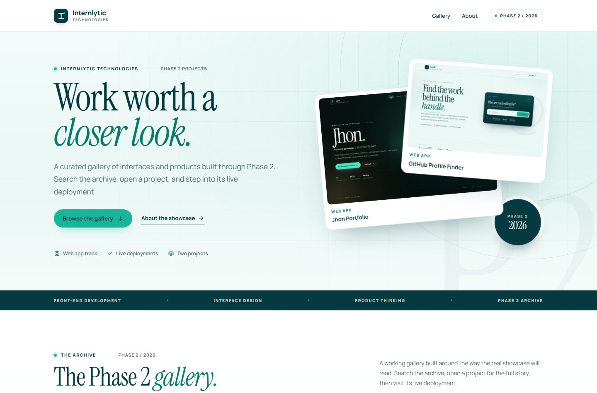
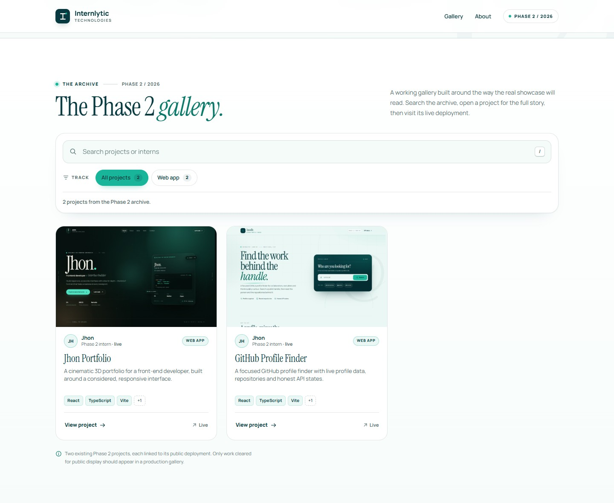
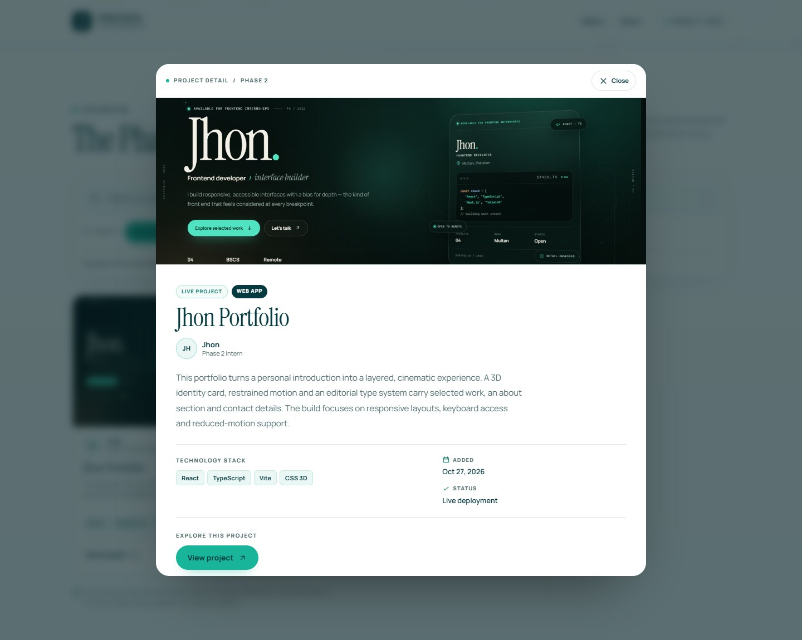
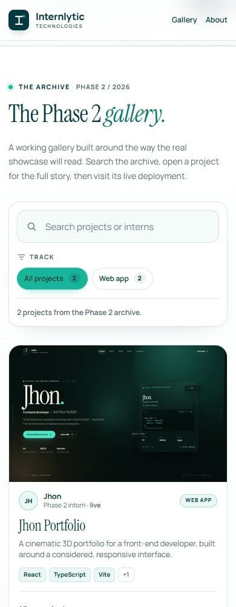
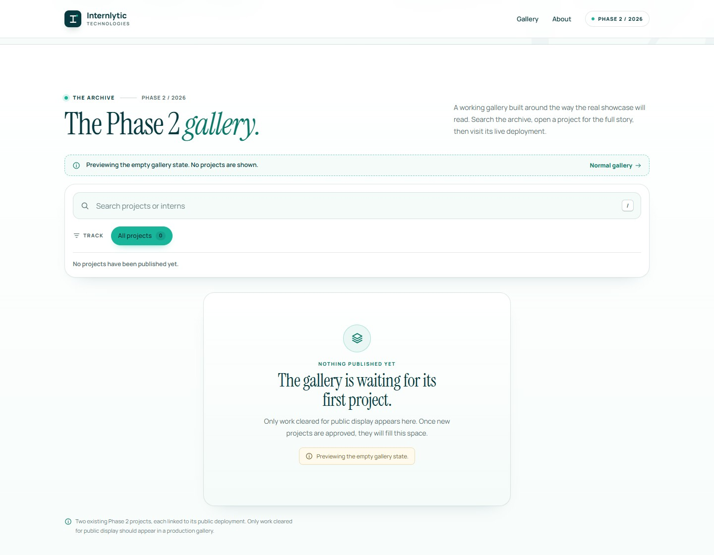
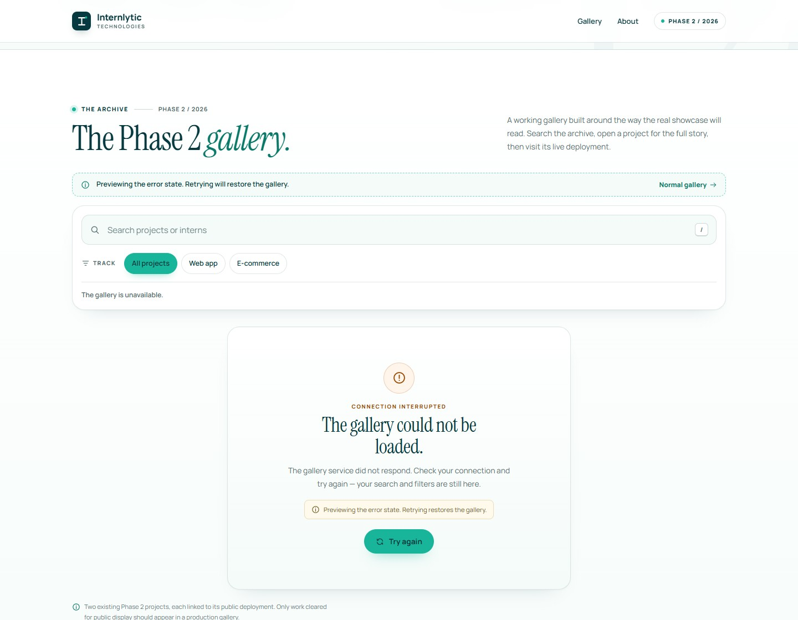
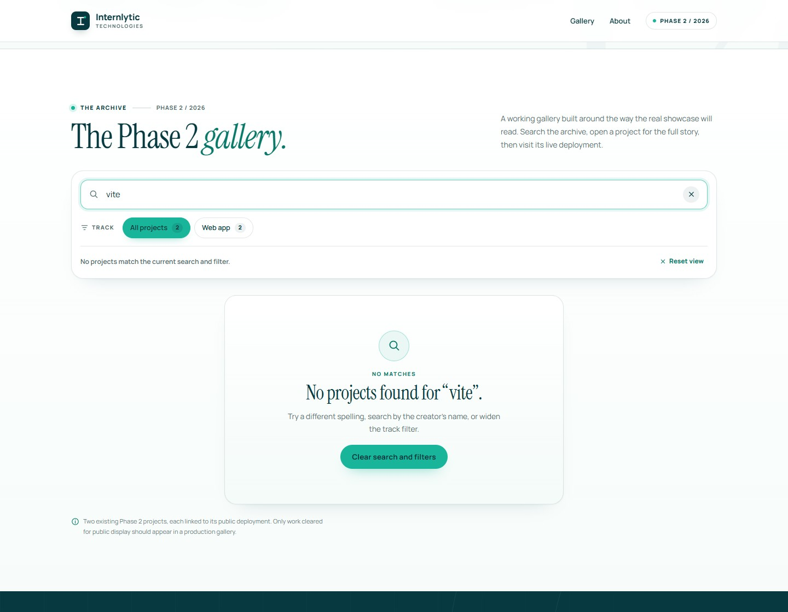

# Internlytic — Phase 2 Projects Showcase

A curated project gallery built for **Internlytic Technologies — Phase 2 Front-End Development, Week 04**. Visitors can browse the archive, search by project title or intern name, filter by track and open any project for its full story and live deployment.



## Overview

The showcase presents **two existing Phase 2 projects**, each linked to its public Netlify deployment. The records describe real work rather than placeholder content: titles, descriptions, technology stacks and thumbnails all match the deployed sites, and every card links straight to the live page.

| Project | Track | Live deployment |
| --- | --- | --- |
| Jhon Portfolio | Web app | <https://week-02-portfolio.netlify.app/> |
| GitHub Profile Finder | Web app | <https://week-03-github-finder.netlify.app/> |

No production Internlytic data, private records or credentials are included. Repository links are omitted rather than pointing at unverified repositories; the interface adds a GitHub button automatically when a record carries a valid URL.

## Features

- **Gallery cards** with a real project screenshot, title, intern name, track, short description, technology tags, a **View project** action and a **Live** link to the deployment.
- **Project detail dialog** with the screenshot, full description, technology stack, the date the entry was added to the archive, approval status and conditional project links. Closes with Escape, the close button or a backdrop click, and returns focus to the card that opened it.
- **Search by project title or intern name** — case- and accent-insensitive, with a `/` keyboard shortcut and Escape to clear.
- **Track filters** with live project counts, `aria-pressed` state and a one-click reset. Only tracks present in the archive are offered, so the toolbar never advertises an empty category. Search and track filters combine.
- **Honest states** — skeleton loading, an empty gallery, a no-results view with the active query and a retryable error message.
- **Demo state previews** through query parameters (`?demo=loading`, `?demo=empty`, `?demo=error`) without changing the archive data.
- **Safe external links** — only `http(s)` URLs are rendered, links are conditional and open in a new tab with `rel="noreferrer"`.
- **Responsive layout** from 320 px phones to widescreen desktops, with consistent spacing, editorial typography and subtle interactions.
- **Accessible by default** — skip link, labelled search, keyboard-operable dialog, live result summaries, visible focus rings and reduced-motion support.
- **No tracking, no storage, no secrets** — the demo is entirely client-side.

| Gallery | Project detail |
| --- | --- |
|  |  |

<p align="center">
  
</p>

| Empty gallery | Error state |
| --- | --- |
|  |  |

| No-results view |
| --- |
|  |

## Tech stack

- React 19 + TypeScript
- Vite 8
- Oxlint
- Plain CSS with custom properties (no UI framework)
- Project screenshots captured from the live deployments as thumbnails

No runtime dependencies beyond React are needed.

## Getting started

Requires Node.js 22+ and npm.

```bash
npm install
npm run dev      # local development server
npm run lint     # Oxlint
npm run build    # TypeScript check + production build
npm run preview  # preview the production build
```

The dev server prints its local URL (Vite defaults to `http://localhost:5173`).

## Live demo

**Not published yet.** The project is ready for GitHub Pages through the included workflow, but it has not been pushed or enabled because the repository authentication step is still pending. The public URL will be added here after the first deployment:

```text
https://<your-username>.github.io/<repository-name>/
```

Until then, use the local commands above. `vite.config.ts` sets `base: './'`, so a build also works from a project subpath. Both featured projects are themselves live at the Netlify URLs listed in the overview table.

## Demo state previews

Append one of these parameters to the local URL:

| URL | What it shows |
| --- | --- |
| `/?demo=loading` | Skeleton gallery held for 12 seconds, so the loading pace can be reviewed. |
| `/?demo=empty` | The empty-gallery state with zero approved records. |
| `/?demo=error` | A failed load with the retry action. Retrying restores the gallery. |

Each preview includes a strip with a link back to the normal gallery. The normal app also shows its loading state briefly on first render.

## Data model

The UI is typed against the fields a Supabase record would supply. `approvalStatus` is checked before any record reaches the gallery.

| Field | Type | Purpose |
| --- | --- | --- |
| `id` | `string` | Stable record key. |
| `projectTitle` | `string` | Card and dialog title. |
| `internName` | `string` | Public display name of the creator. |
| `track` | `'Web app' \| 'E-commerce'` | Primary filter. |
| `description` | `string` | Short card summary. |
| `longDescription` | `string` | Full dialog copy. |
| `thumbnailUrl` | `string` | Screenshot of the live project. |
| `thumbnailAlt` | `string` | Descriptive alternative text. |
| `liveUrl` | `string \| null` | Public deployment, when supplied. |
| `githubUrl` | `string \| null` | Public repository, when supplied. |
| `technologies` | `string[]` | Technology stack tags. |
| `approvalStatus` | `'approved' \| 'pending'` | Only `approved` records are displayed. |
| `createdAt` | ISO date string | Date the entry was added to this archive; used for ordering. |

The two records live in [`src/data/projects.ts`](src/data/projects.ts). Both are Web app projects, so the gallery offers the **All projects** and **Web app** filters; the model still supports E-commerce for future submissions. Thumbnails are screenshots of the deployed sites captured at 1440 × 900, and `createdAt` records when each entry joined this showcase rather than the original build date. `githubUrl` is `null` for both records because no verified public repository exists for them; the interface never invents destinations.

## Future Supabase integration

The current data layer in [`src/lib/projects.ts`](src/lib/projects.ts) is an async stand-in for a database query. It already returns a promise, filters for approved records and supports aborting, so it can be replaced without changing the components.

A safe public integration would follow these rules:

1. **Public read of approved work only.** Enable Row Level Security and add a select policy for `approval_status = 'approved'`. Never rely on the client to hide unapproved rows.
2. **No write access for the gallery client.** The public anon role needs `select` only. Inserts, updates and deletes belong to an authenticated staff workflow and are not part of this front end.
3. **Public fields only.** Store only information the intern and company have approved for the public gallery. Do not add private contact details, internal notes or unpublished project metadata to public columns.
4. **No secret keys in the browser.** Only the public anon key can be shipped; the service-role key must stay on a server. Environment files are ignored by `.gitignore` (`*.local`); no credentials are committed in this repository.
5. **Validate links again on the client.** Keep the existing `http(s)` check so a malformed record cannot become an executable or unexpected link.

Illustrative schema and policy:

```sql
create table public.projects (
  id uuid primary key default gen_random_uuid(),
  project_title text not null,
  intern_name text not null,
  track text not null check (track in ('Web app', 'E-commerce')),
  description text not null,
  long_description text,
  thumbnail_url text,
  thumbnail_alt text,
  live_url text,
  github_url text,
  technologies text[] not null default '{}',
  approval_status text not null default 'pending' check (approval_status in ('approved', 'pending')),
  created_at timestamptz not null default now()
);

alter table public.projects enable row level security;

create policy "Approved projects are publicly readable"
on public.projects
for select
to anon, authenticated
using (approval_status = 'approved');
```

The eventual query is a direct swap inside `loadProjects`:

```ts
const { data, error } = await supabase
  .from('projects')
  .select('id, project_title, intern_name, track, description, long_description, thumbnail_url, thumbnail_alt, live_url, github_url, technologies, approval_status, created_at')
  .eq('approval_status', 'approved')
  .order('created_at', { ascending: false })
```

Supabase's public anon key is designed to be visible; it is still read from `VITE_SUPABASE_URL` and `VITE_SUPABASE_ANON_KEY`, never hard-coded or committed. The service-role key must never appear in this project.

## Accessibility

- The page starts with a skip link and moves focus to `<main>`.
- The search field has a real label, a keyboard shortcut and a clear button with an accessible name.
- Filters expose `aria-pressed`; the result summary is a polite live region.
- The project dialog is a native `<dialog>` with `showModal()`, focus placement on the close control, focus restoration to the triggering card and a scroll lock on the page behind it.
- Error messages use `role="alert"`; decorative artwork is hidden from assistive technology; thumbnails have descriptive alt text.
- Focus styles are always visible, and transitions are removed under `prefers-reduced-motion`.
- Automated [axe-core](https://github.com/dequelabs/axe-core) audits returned **0 violations** for the gallery, an open project dialog and the mobile dialog.

## Testing

Verified in Chrome with Playwright:

- search by project title (`portfolio` → one result) and by intern name (`Jhon` → both projects), a technology keyword (`vite`, correctly no results because search is scoped to title and intern), Escape to clear and the `/` shortcut;
- track filters and their counts (`Web app` → two results, and the empty E-commerce chip is not rendered), a combined search and filter, a conflicting combination that keeps the honest no-results copy, and reset;
- every card exposes exactly one `Live` link pointing at the supplied deployment with `target="_blank"` and `rel="noreferrer"`, and no fabricated repository link;
- dialog open, title, live flag, deployment link, body scroll lock, Escape close, backdrop close, close button and focus return;
- empty, loading, error and retry flows through the demo parameters; no-results copy with the active query;
- keyboard Tab order, skip link, reduced motion, no console errors;
- viewports at 320, 390, 768, 1024 and 1440 px with no horizontal overflow and no broken images;
- `npm run lint` and `npm run build` pass.

## Design

Brand palette used across the interface:

| Token | Value | Use |
| --- | --- | --- |
| Teal green | `#18B59A` | Primary buttons, accents, active filters |
| Deep blue-green | `#073A40` | Headings, strong surfaces, navigation |
| White | `#FFFFFF` | Cards and content surfaces |
| Light background | `#EAF7F4` | Page and section tint |

Typography pairs Instrument Serif for editorial headlines with Manrope for interface text. Card and dialog artwork is screenshots of the two deployed projects, cropped to a consistent 8:5 ratio; the hero collage layers the same two captures as desktop-style preview cards.

> **Logo note:** the official Internlytic logo file was not supplied with this brief. The header uses a clearly marked typographic placeholder wordmark and lettermark, with fixed proportions and no distortion. Replace the mark in [`src/components/BrandMark.tsx`](src/components/BrandMark.tsx) and [`public/favicon.svg`](public/favicon.svg) when the official asset is available.

## Project structure

```text
src/
  App.tsx                  Page composition and skip link
  components/              Header, Hero, gallery toolbar, cards, dialog,
                           states, About panel, Footer, BrandMark, Icon
  data/projects.ts         Two approved live-project records
  hooks/useProjects.ts     Loading, success and error state machine
  lib/projects.ts          Async loader and demo-state handling
  lib/format.ts            Search, date formatting and safe URL helpers
  styles/global.css        Tokens, layout, components, responsive rules
  types.ts                 Track, approval status and Project types
docs/                      README preview images
public/
  thumbnails/              Two screenshots of the live projects
  favicon.svg              Placeholder brand mark
  og-cover.jpg             1200 × 630 social cover
```

## Deployment

A GitHub Pages workflow lives at `.github/workflows/deploy.yml`. It runs on pushes to `main` (or manually), installs dependencies, lints, builds and publishes `dist`.

1. Create a repository and push this folder to `main`.
2. In the repository, open **Settings → Pages** and set **Source** to **GitHub Actions**.
3. The workflow builds and deploys the site.
4. Add the resulting URL to the **Live demo** section and update the Open Graph image URLs in `index.html` to absolute URLs for reliable social previews.

## Limitations

- The two records describe existing public deployments owned by the intern; the gallery itself has no production database connection.
- Repository links are omitted because no verified public repository exists for these projects. The UI adds those buttons automatically when a valid URL is present.
- Thumbnails are static captures of the live sites; if a deployment changes, its screenshot drifts until it is recaptured.
- The official Internlytic logo was not provided; the current wordmark is a documented placeholder.
- The live demo is pending repository authentication and GitHub Pages setup.
- Fonts load from Google Fonts; an offline browser falls back to system fonts.
- Search covers project titles and intern names as specified. It does not search descriptions or technologies.
- The gallery is a static front end: there is no admin review workflow, upload flow or persistence.

---

Built for Internlytic Technologies · Phase 2 / Week 04 · 2026.
